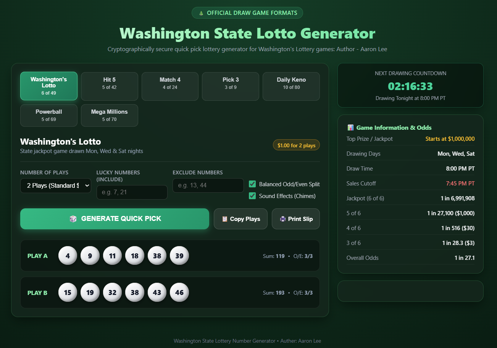

# 🌲 Washington State Lottery Quick Pick & Number Generator: Author: Aaron Lee

A cryptographically secure, fully customizable number generator and quick pick tool for **Washington's Lottery** games, featuring both a rich interactive **Web UI** and a high-performance **CLI tool**.

---



## 🎮 Supported Washington State Lottery Games

| Game | Format | Ticket Cost | Draw Schedule (PT) | Cutoff Time | Top Prize / Jackpot |
| :--- | :--- | :--- | :--- | :--- | :--- |
| **Washington's Lotto** | 6 of 49 | $1.00 (2 plays) | Mon, Wed, Sat @ 8:00 PM | 7:45 PM | Starts at $1,000,000 |
| **Hit 5** | 5 of 42 | $1.00 per play | Daily @ 8:00 PM | 7:45 PM | Starts at $100,000 |
| **Match 4** | 4 of 24 | $2.00 per play | Daily @ 8:00 PM | 7:45 PM | $10,000 Fixed Top Prize |
| **Pick 3** | 3 digits (0-9) | $0.50 or $1.00 | Daily @ 8:00 PM | 7:45 PM | $500 (Straight on $1) |
| **Daily Keno** | 10 of 80 | $1.00 to $5.00 | Daily @ 8:00 PM | 7:45 PM | Up to $100,000 |
| **Powerball (WA)** | 5 of 69 + PB (1-26)| $2.00 per play | Mon, Wed, Sat @ 7:59 PM | 7:45 PM | Multi-million Jackpot |
| **Mega Millions (WA)**| 5 of 70 + MB (1-25)| $2.00 per play | Tue, Fri @ 8:00 PM | 7:45 PM | Multi-million Jackpot |

---

## 🚀 Key Features

* **True Cryptographic Randomness**: Uses `node:crypto` (`randomInt`) and the browser's `crypto.getRandomValues()` rather than pseudorandom `Math.random()`, ensuring cryptographically unbiased selection.
* **Smart Strategy Filters**:
  * **Lucky Numbers Pinning**: Lock your favorite numbers in every generated line.
  * **Number Exclusion**: Filter out numbers you don't want.
  * **Balanced Odd/Even Split**: Automatically balance combinations according to standard lottery statistical distributions.
* **Official WA State Rules Enforced**:
  * Washington's Lotto defaults to 2 plays (standard $1 playslip).
  * Enforces proper range constraints, unique non-repeating balls for draw games, and duplicates for Pick 3.
* **Interactive Web App (`index.html`)**:
  * Realistic 3D lottery balls with physical styling and shine.
  * Real-time countdown to the next 8:00 PM Pacific Time draw.
  * Synthesized sound effects (Web Audio API).
  * 1-click clipboard copy and printable play slip.
* **Terminal CLI Tool (`cli.js`)**:
  * Colorful ASCII ticket slips, statistical sum breakdown, and quick pick generator for all games.

---

## 💻 CLI Usage

Run directly with Node.js:

```bash
# Default: Generate standard 2-play Washington's Lotto ticket ($1)
node cli.js

# Generate 5 plays of Hit 5
node cli.js -g hit5 -n 5

# Generate Match 4 quick pick
node cli.js -g match4

# Generate Powerball quick pick with lucky number 7 included
node cli.js -g powerball --lucky 7

# Generate all Washington State lottery games in one slip
node cli.js --all

# View complete directory of games, schedules, and prize structures
node cli.js --list

# Show help options
node cli.js --help
```

### Command Flags:
* `-g, --game <id>`: `lotto`, `hit5`, `match4`, `pick3`, `dailykeno`, `powerball`, `megamillions`
* `-n, --plays <count>`: Number of lines to generate
* `-a, --all`: Generate quick picks across all WA lottery games
* `-l, --list`: Show schedules, cutoff times, and odds
* `--lucky <csv>`: Comma-separated numbers to guarantee in the selection
* `--exclude <csv>`: Comma-separated numbers to exclude
* `--balanced`: Enable odd/even balance filter

---

## 🌐 Web Application

Simply open [`index.html`](index.html) in any modern web browser, or launch a quick local preview:

```bash
npx serve .
# or
npx http-server .
```

---

## 🧪 Running Tests

A comprehensive unit test suite is included in `tests/lottery.test.js`:

```bash
npm test
```

---
